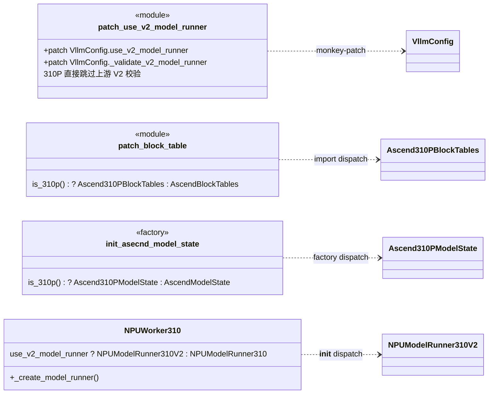
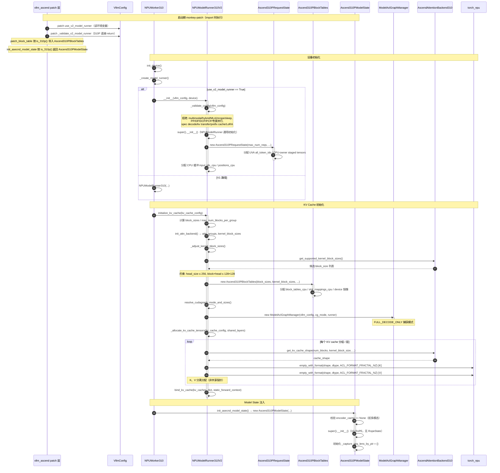
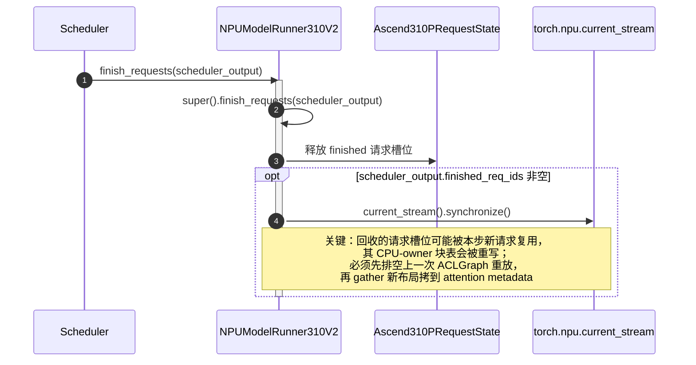

# PR #14761 —— 310P 适配 Model Runner V2（Qwen3 Dense / MoE）

> 仓库：`vllm-project/vllm-ascend`，PR：[#14761](https://github.com/vllm-project/vllm-ascend/pull/14761)
> 标题：`[Feature][310P] Adapting MRV2 for the 310P`
> 合入：2026-08-26，base commit `6fd6ea1`，head commit `95aa93d`

本文基于该 PR 的 15 个变更文件（新增 1566 行）梳理其**类结构**与**执行时序**，使用标准 UML 符号绘制（Mermaid 语法，黑白渲染）。

---

## 0. PR 概述

为 Ascend 310P（Atlas 300I Duo）启用 vLLM 的 Model Runner V2（MRV2）执行路径，覆盖：

| 能力 | 说明 |
|------|------|
| 模型 | Qwen3 Dense（如 Qwen3-8B，fp16）、Qwen3 MoE（如 Qwen3-30B-A3B-W8A8，ascend W8A8 量化） |
| 并行 | 仅张量并行（TP）；PP / DP / CP / 专家并行均 `NotImplementedError` |
| 执行 | Eager 与 ACLGraph（`FULL_DECODE_ONLY` 捕获） |
| KV Cache | NZ 格式（`ACL_FORMAT_FRACTAL_NZ`），K / V 分离分配 |
| 关键替换 | 用 CPU-owner 实现替换 vLLM 上游依赖 Triton 的 request state / sampler / block-table / 输入准备 |

> **重要**：Qwen3 Dense 与 MoE 在 MRV2 runner 层走**同一条代码路径**，差异仅在 `Model` 前向内部（MoE 含专家路由、W8A8 量化层），不在本 PR 改动范围内。因此下述时序图对二者通用。

核心改动文件：

```
vllm_ascend/_310p/worker/v2/
├── model_runner.py     # NPUModelRunner310V2（668 行，主体）
├── block_table.py      # Ascend310PBlockTables（CPU-owner 块表）
├── model_state.py      # Ascend310PModelState（ACLGraph seq_lens 续接 + 采样器注入）
├── sampler.py          # Ascend310PSampler（Triton-free 贪心采样）
└── states.py           # Ascend310PRequestState + Ascend310PStagedWriteTensor
vllm_ascend/_310p/worker_310p.py                # NPUWorker310._create_model_runner 派发
vllm_ascend/_310p/attention/metadata_builder.py # DecodeOnly 也绑定设备侧 seq_lens
vllm_ascend/patch/platform/patch_use_v2_model_runner.py   # 310P 跳过上游 V2 校验
vllm_ascend/patch/worker/patch_v2/patch_block_table.py     # is_310p 派发块表实现
vllm_ascend/worker/v2/model_states/__init__.py             # is_310p 派发 model state
```

---

## 1. 类图（Class Diagram）

UML 符号约定：`<|--` 泛化（空心三角）、`*--` 组合（实心菱形）、`o--` 聚合（空心菱形）、`-->` 关联、`..>` 依赖（虚线）。

```mermaid
classDiagram
    direction LR

    class NPUWorker310 {
        +use_v2_model_runner: bool
        +vllm_config: VllmConfig
        +device: torch.device
        +model_runner: NPUModelRunner310
        +_create_model_runner() NPUModelRunner
        +init_device()
    }

    class NPUModelRunner310V2 {
        -_validate_config(vllm_config)
        +req_states: Ascend310PRequestState
        +block_tables: Ascend310PBlockTables
        +model_state: Ascend310PModelState
        +cudagraph_manager: ModelAclGraphManager
        +kernel_block_sizes: list~int~
        +input_ids_cpu: Tensor
        +positions_cpu: Tensor
        +prepare_inputs(scheduler_output, batch_desc) AscendInputBatch
        -_prepare_inputs_310p(scheduler_output, batch_desc) AscendInputBatch
        +initialize_kv_cache(kv_cache_config)
        -_adjust_kernel_block_sizes(kv_cache_config)
        -_allocate_kv_cache_tensors(kv_cache_config, shared_layers) dict
        -_prepare_prefill_inputs(...) void
        -_prepare_pos_seq_lens(...) void
        -_combine_sampled_and_draft_tokens(...) Tensor
        +prepare_attn(input_batch) tuple
        +sample(hidden_states, input_batch, grammar_output)
        +postprocess_sampled(...) void
        +postprocess_num_computed_tokens(input_batch) void
        +finish_requests(scheduler_output) void
        {_get_valid_query_lens(idx, qsl) Tensor}
    }

    class Ascend310PBlockTables {
        +block_tables_cpu: list~ndarray~
        +input_block_tables_cpu: list~ndarray~
        +input_block_tables: list~Tensor~
        +slot_mappings_cpu: ndarray
        +slot_mappings: Tensor
        +kernel_block_sizes: list~int~
        +blocks_per_kv_block: list~int~
        +append_block_ids(req_index, new_block_ids, overwrite)
        +gather_block_tables(idx_mapping, num_reqs_padded) tuple
        +compute_slot_mappings(idx, qsl, positions, num_tokens_padded) Tensor
        +get_dummy_block_tables(num_reqs) tuple
        {init_block_table_layout_tensors() void}
        {apply_staged_writes() void}
    }

    class Ascend310PModelState {
        -_capture_seq_lens_by_ptr: dict~int,Tensor~
        -_record_capture_seq_lens(seq_lens) void
        -_refresh_capture_seq_lens(runtime_seq_lens) void
        +prepare_attn(input_batch, cg_mode, ..., for_capture) dict
        +custom_sampler(sampler) tuple
    }

    class Ascend310PSampler {
        +penalties_state: SimpleNamespace
        +add_request(req_idx, prompt_len, sampling_params) void
        +apply_staged_writes() void
        +__call__(logits, input_batch) SamplerOutput
    }

    class Ascend310PRequestState {
        +all_token_ids: Ascend310PStagedWriteTensor
        +total_len: Ascend310PStagedWriteTensor
        +num_computed_tokens: Ascend310PStagedWriteTensor
        +num_computed_tokens_np: ndarray
        +prefill_len: UvaBackedTensor
        +last_sampled_tokens: Tensor
        +next_prefill_tokens: Tensor
        +req_id_to_index: dict
        +add_request(req_id, prompt_len, all_token_ids, num_computed_tokens)
    }

    class Ascend310PStagedWriteTensor {
        +cpu: Tensor
        +np: ndarray
        +gpu: Tensor
        -_dirty_indices: set~int~
        +stage_write(index, start, values) void
        +stage_write_elem(index, value) void
        +apply_write() void
    }

    class ModelAclGraphManager {
        +capture(runner, batch_size)
        +replay(input_batch)
    }

    class AscendAttentionBackend310 {
        <<static>>
        +get_kv_cache_shape(num_blocks, block_size, num_kv_heads, head_size, cache_type) tuple
        +get_supported_kernel_block_sizes() list~int~
    }

    %% 泛化（空心三角）
    NPUModelRunner310V2 --|> NPUModelRunner
    Ascend310PBlockTables --|> BlockTables
    Ascend310PModelState --|> AscendModelState
    Ascend310PRequestState --|> AscendRequestState

    %% 聚合（空心菱形）：Worker 创建并持有 runner
    NPUWorker310 o-- NPUModelRunner310V2 : use_v2_model_runner

    %% 组合（实心菱形）：runner 在 __init__/initialize_kv_cache 中创建并拥有
    NPUModelRunner310V2 *-- Ascend310PRequestState : req_states
    NPUModelRunner310V2 *-- Ascend310PBlockTables : block_tables
    NPUModelRunner310V2 *-- ModelAclGraphManager : cudagraph_manager
    Ascend310PModelState *-- Ascend310PSampler : custom_sampler()注入
    Ascend310PRequestState *-- Ascend310PStagedWriteTensor : all_token_ids/total_len/num_computed_tokens

    %% 依赖（虚线箭头）
    NPUModelRunner310V2 ..> AscendAttentionBackend310 : KV cache shape
    NPUModelRunner310V2 ..> AscendInputBatch : 构造
    NPUModelRunner310V2 ..> Ascend310PModelState : init_asecnd_model_state工厂
    Ascend310PRequestState ..> UvaBackedTensor : prefill_len
```

### 类关系说明

| 符号 | 关系 | 含义 |
|------|------|------|
| `NPUModelRunner310V2 ─△ NPUModelRunner` | 泛化 | 310P V2 runner 继承通用 Ascend V2 runner，重写 8 个方法 |
| `Ascend310PBlockTables ─△ BlockTables` | 泛化 | 继承 vLLM 上游块表，重写为 CPU-owner 版本 |
| `Ascend310PModelState ─△ AscendModelState` | 泛化 | 继承默认 model state，重写 `prepare_attn` 与 `custom_sampler` |
| `Ascend310PRequestState ─△ AscendRequestState` | 泛化 | 继承上游 request state，替换 Triton staged-write |
| `NPUWorker310 ◇─ NPUModelRunner310V2` | 聚合 | Worker 按 `use_v2_model_runner` 选择 V2 或 V1 runner |
| `NPUModelRunner310V2 ◆─ Ascend310PRequestState` | 组合 | runner 构造时创建并独占 request state |
| `NPUModelRunner310V2 ◆─ Ascend310PBlockTables` | 组合 | `initialize_kv_cache` 中创建 |
| `Ascend310PModelState ◆─ Ascend310PSampler` | 组合 | `custom_sampler()` 返回贪心采样器实例 |
| `Ascend310PRequestState ◆─ Ascend310PStagedWriteTensor` | 组合 | token/长度字段用 CPU-owner 暂存写 |

### 派发（patch）入口

本 PR 通过三处 `is_310p()` 派发，把通用 Ascend V2 实现替换为 310P 专用实现：



---

## 2. 时序流程图（Sequence Diagram）

UML 符号约定：实线实心箭头 `->>` 同步调用、虚线开口箭头 `-->` 返回、`activate/deactivate` 生命线、`alt/opt/loop` 为交互片段。

### 2.1 初始化时序



### 2.2 单步推理时序（Qwen3 Dense / MoE 通用）

> 以下为 `execute_model` 单步调度，**对 Qwen3 Dense（fp16）与 Qwen3 MoE（W8A8）完全一致**：差异仅在 `Model.forward` 内部（MoE 走专家路由 + W8A8 量化算子），不在 MRV2 runner 改动范围。

```mermaid
sequenceDiagram
    autonumber
    participant Sched as Scheduler
    participant Worker as NPUWorker310
    participant Runner as NPUModelRunner310V2
    participant ReqState as Ascend310PRequestState
    participant BlockTable as Ascend310PBlockTables
    participant ModelState as Ascend310PModelState
    participant Model as Qwen3 Dense / MoE
    participant Sampler as Ascend310PSampler
    participant AclGraph as ModelAclGraphManager

    Sched->>Worker: execute_model(scheduler_output)
    Worker->>Runner: run(scheduler_output, batch_desc)
    activate Runner

    Note over Runner: ① 输入准备（Triton-free，CPU 主导）
    Runner->>Runner: prepare_inputs(scheduler_output, batch_desc)
    Runner->>Runner: _prepare_inputs_310p()
    Runner->>ReqState: 读取 num_computed_tokens_np / prefill_len.np / all_token_ids
    ReqState-->>Runner: CPU numpy 视图
    Runner->>Runner: sort_batch_req_ids / 构造 idx_mapping_np / query_start_loc_np
    Runner->>Runner: async_copy_to_gpu(idx_mapping) / async_copy_to_gpu(query_start_loc)
    opt batch 含 prefill 请求
        Runner->>Runner: _prepare_prefill_inputs()（CPU 回退）
        Note over Runner: 从 all_token_ids.cpu 取 prompt token，<br/>填 input_ids_cpu → copy_ 到 device
    end
    Runner->>Runner: _prepare_pos_seq_lens()（CPU 回退）
    Note over Runner: positions_cpu = arange(num_computed, num_computed+n_tokens)<br/>seq_lens_cpu = num_computed + n_tokens → copy_ 到 device
    Runner->>Runner: _combine_sampled_and_draft_tokens()（CPU 回退）
    Note over Runner: logits_indices_np = query_end-1；<br/>decode 请求把 last_sampled_tokens 拷回 input_ids
    Runner->>Runner: 构造 AscendInputBatch(**kwargs)
    Runner->>Runner: update_cos_sin(positions)（1D RoPE）
    Runner-->>Runner: input_batch

    Note over Runner: ② Attention 元数据（块表 + slot mapping）
    Runner->>BlockTable: gather_block_tables(idx_mapping_np, num_reqs_padded)
    activate BlockTable
    BlockTable->>BlockTable: CPU numpy gather block_tables_cpu → host_output
    BlockTable->>BlockTable: copy_ 到 input_block_tables（device, non_blocking）
    BlockTable-->>Runner: tuple[Tensor]（device 块表）
    deactivate BlockTable
    Runner->>BlockTable: compute_slot_mappings(idx, query_start_loc, positions, num_tokens_padded)
    activate BlockTable
    BlockTable->>BlockTable: CPU 计算 block_number×block_size+offset → slot_mappings_cpu
    BlockTable->>BlockTable: copy_ 到 device slot_mappings（non_blocking）
    BlockTable-->>Runner: slot_mappings[:, :num_tokens_padded]
    deactivate BlockTable

    Note over Runner: ③ Model State 准备（ACLGraph seq_lens 续接）
    Runner->>ModelState: prepare_attn(input_batch, cg_mode, block_tables, slot_mappings, ..., for_capture)
    activate ModelState
    opt for_capture == True（捕获期）
        ModelState->>ModelState: _record_capture_seq_lens(input_batch.seq_lens)
        Note over ModelState: 按 data_ptr 记录最大捕获视图
    else cg_mode == FULL（重放期）
        ModelState->>ModelState: _refresh_capture_seq_lens(input_batch.seq_lens)
        Note over ModelState: 把运行时 seq_lens 拷到所有捕获期绑定地址
    end
    ModelState->>ModelState: super().prepare_attn()（生成 attn_metadata）
    ModelState-->>Runner: attn_metadata
    deactivate ModelState

    Note over Runner: ④ 前向（Eager 或 ACLGraph 重放）
    opt cg_mode == FULL 且已捕获
        Runner->>AclGraph: replay(input_batch)
        AclGraph->>Model: 重放捕获的计算图
    else Eager / Piecewise
        Runner->>Model: forward(input_ids, positions, attn_metadata, kv_caches)
    end
    Note over Model: Dense: 标准 Transformer 层<br/>MoE: 路由到 top-k 专家 + W8A8 量化算子
    Model-->>Runner: hidden_states

    Note over Runner: ⑤ 采样（Triton-free 贪心）
    Runner->>Model: compute_logits(hidden_states[logits_indices])
    Model-->>Runner: logits
    opt grammar_output != None
        Runner->>Runner: raise NotImplementedError（310P MRV2 暂不支持结构化输出）
    end
    Runner->>Sampler: __call__(logits, input_batch)
    activate Sampler
    Sampler->>Sampler: sampled = logits.argmax(dim=-1).to(int32)
    Sampler-->>Runner: SamplerOutput(sampled_token_ids, num_sampled=ones, num_rejected=zeros)
    deactivate Sampler
    Runner->>Runner: can_sample_np = seq_lens ≥ prefill_len
    Runner->>Runner: num_sampled = async_copy_to_gpu(can_sample_np)

    Note over Runner: ⑥ 后处理（更新 request state）
    Runner->>Runner: postprocess_sampled(idx_mapping, sampled_tokens, num_sampled, ...)
    Runner->>ReqState: index_put_ all_token_ids[req, total_len] = stored_tokens
    Runner->>ReqState: index_copy_ last_sampled_tokens
    Runner->>ReqState: index_add_ total_len += num_sampled
    Runner->>Runner: _get_valid_query_lens(idx, query_start_loc)（剔除 ACLGraph padding）
    Runner->>ReqState: index_add_ num_computed_tokens += query_lens
    Runner->>ModelState: postprocess_state(idx_mapping, num_sampled)

    Runner->>Runner: postprocess_num_computed_tokens(input_batch)
    Runner->>ReqState: index_add_ num_computed_tokens += (qsl[1:]-qsl[:-1])

    Runner-->>Worker: sampler_output
    deactivate Runner
    Worker-->>Sched: output
```

### 2.3 请求结束 / 块表回收时序



---

## 3. 关键设计要点

### 3.1 为何需要一套 310P 专用 MRV2 实现

vLLM MRV2 上游在 request state、sampler、block-table、输入准备等环节依赖 **Triton kernel**（staged write、pointer table、argmax 核等）。310P 不支持 Triton，因此本 PR 用 **CPU-owner + numpy + async H2D copy** 的方式重写这些环节，保持与 310P MRV1 相同的数据通路。

> 代码注释多处标注：待 vLLM RFC #45133（Triton Kernel Dispatcher）合入后，这些 310P override 将重构为通过 Dispatcher 注册的实现，而非独立子类。

### 3.2 ACLGraph 与 seq_lens 续接

ACLGraph 重放时使用**捕获期绑定的张量地址**。310P 的 `seq_lens` 在不同 batch size 下可能指向不同视图（`common_attn_metadata.seq_lens[:num_reqs]`），因此：

- **捕获期**（`for_capture=True`）：`Ascend310PModelState._record_capture_seq_lens()` 按 `data_ptr` 记录每个物理缓冲的最大视图。
- **FULL 重放期**：`_refresh_capture_seq_lens()` 把运行时 `seq_lens` 拷贝到**所有**捕获期记录的缓冲，保证重放读到正确长度。
- **`metadata_builder.py`** 同时调整：`DecodeOnly` 与 splitfuse 状态都在捕获前绑定设备侧 `seq_lens` / `query_start_loc` 视图，避免重放时触发 pageable H2D 拷贝。

### 3.3 NZ 格式 KV Cache

310P paged attention 要求 `ACL_FORMAT_FRACTAL_NZ` 布局，且：

- K、V **分离分配**（不同 `data_ptr`），不支持非对称 K/V head size。
- `kernel_block_size` 可能小于逻辑 `block_size`（受 `block_size × head_size ≤ 128×128` 约束），`Ascend310PBlockTables.append_block_ids` 会把一个逻辑块展开为多个 kernel 块。

### 3.4 配置约束（`_validate_config`）

启动即硬性拒绝的能力（均为 `NotImplementedError`）：

| 类别 | 拒绝项 |
|------|--------|
| 模型 | multimodal / hybrid / MLA / mrope / sleep mode |
| 并行 | PP / DP / DCP / PCP / 专家并行（仅允许 TP） |
| 特性 | speculative decoding / KV cache transfer / prefix caching / LoRA |
| 采样 | 非 greedy（temperature≠0 / top_p / top_k / min_p / penalty / logprobs / logits processor） |
| KV spec | 非 AttentionSpec / head_size > 256 / 非对称 K/V head |

---

## 4. 测试覆盖

| 文件 | 类型 | 覆盖点 |
|------|------|--------|
| `tests/ut/_310p/test_model_runner_v2_310p.py`（328 行） | 单元 | 配置校验、request state 注入、`prepare_inputs` 派发、`finish_requests` 同步、采样器拒绝随机采样、块表 gather/slot、NZ K/V 分离分配、model state 贪心采样器与 seq_lens 刷新、ACLGraph query lens 剔除 padding、Worker 选择 V2 runner |
| `tests/e2e/pull_request/four_card/_310p/test_model_runner_v2_310p.py`（44 行） | 端到端 | Qwen3-8B Dense TP2 ACLGraph fp16；Qwen3-30B-A3B MoE TP2 ACLGraph W8A8 |

---

## 附：UML 符号速查

| 符号 | 名称 | 含义 | Mermaid |
|------|------|------|---------|
| ─△▷ | 泛化 Generalization | 子类继承父类 | `A <|-- B` |
| ◆─ | 组合 Composition | 整体创建并独占部分，同生共死 | `A *-- B` |
| ◇─ | 聚合 Aggregation | 整体持有部分，但部分生命周期独立 | `A o-- B` |
| ──> | 关联 Association | 持有引用 | `A --> B` |
| ┄┄> | 依赖 Dependency | 使用但不持有 | `A ..> B` |
| ─△▷（虚线） | 实现 Realization | 接口实现 | `A ..|> B` |
| 实线实心箭头 | 同步调用 | 时序图：调用消息 | `A ->> B` |
| 虚线开口箭头 | 返回 | 时序图：返回消息 | `A --> B` |
