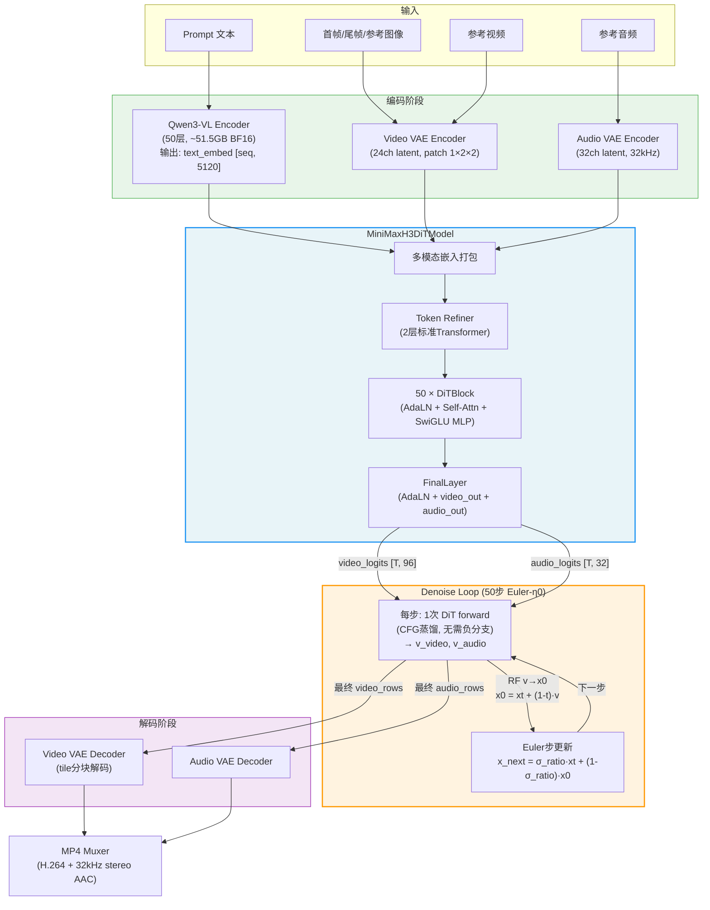
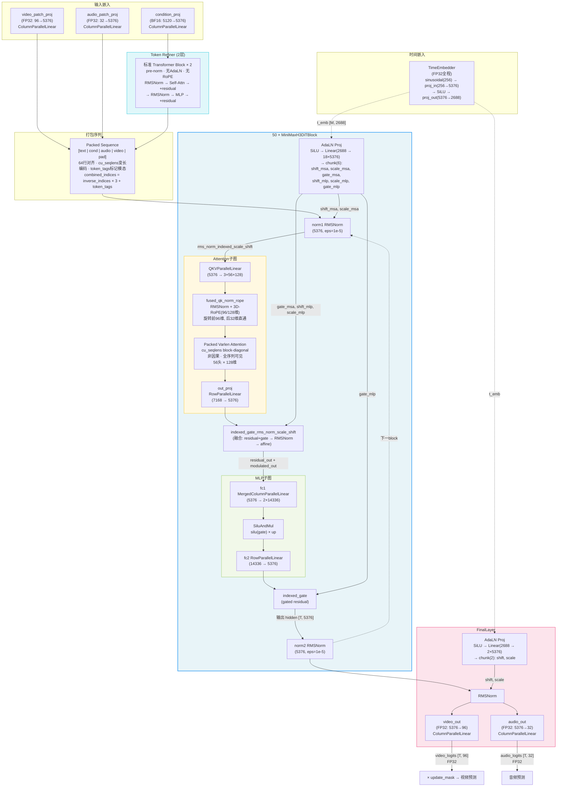
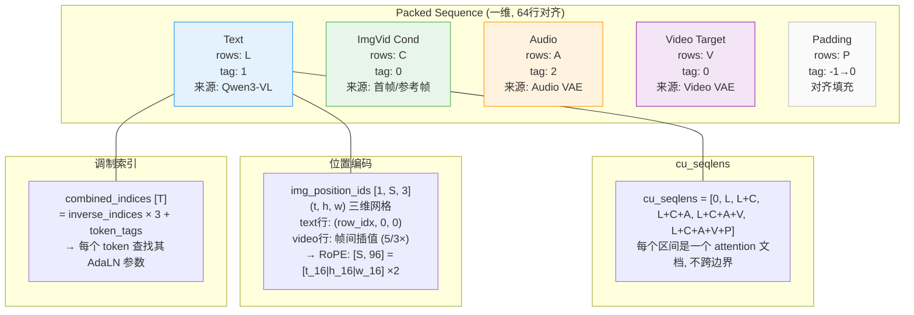
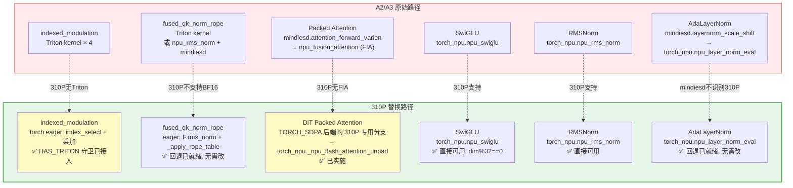
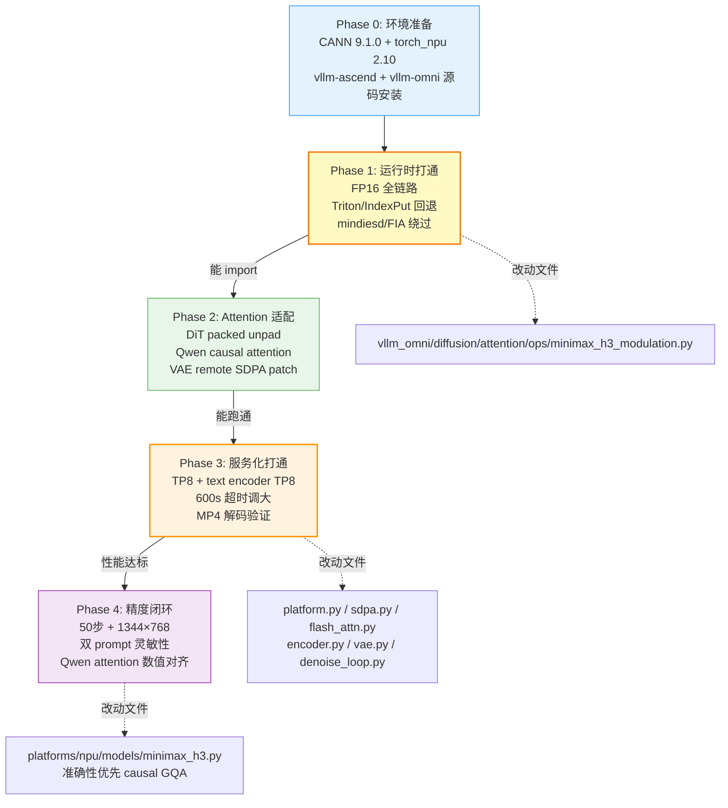

# MiniMax H3 模型结构分析、关键算子与 310P 适配指南

> 文档状态：已按 2026-09-21 实际适配代码和 310P 运行结果更新。
> 硬件约束已确认：310P 不支持 BF16，不支持 FIA，PyTorch SDPA 不能作为实际回退。
> 当前策略：模型主干 FP16；DiT/VAE 非因果 attention 用 310P `_npu_flash_attention_unpad`；Qwen3-VL 文本编码器的 causal GQA 使用显式 FP32 attention 参考实现，优先保证 prompt 语义精度。

## 实施摘要

| 链路 | 310P 问题 | 实际处理 |
|---|---|---|
| 全局 dtype | BF16 计算/HCCL 不可用 | 服务、stage、Qwen3-VL、DiT 统一 FP16；必要的 all-reduce/调度器累加保留 FP32 |
| Qwen3-VL causal attention | `F.scaled_dot_product_attention` 报错；内部 flash kernel 能跑但缺少数值等价保证 | 显式 GQA KV 展开 + FP32 `QKᵀ` + causal mask + FP32 softmax + `PV` |
| Qwen3-VL TP8 | BF16 HCCL 失败 | embedding/row-parallel 归约转 FP32，归约后转回 FP16 |
| DiT packed attention | FIA/mindiesd 不支持；SDPA 不可用 | `TORCH_SDPA` 后端在 310P 分支调 `_npu_flash_attention_unpad` |
| VAE attention | remote-code `_sdpa_attention` 不可用 | 定位 remote module 并 monkey-patch 为 `_npu_flash_attention_unpad` 实现 |
| 布尔索引赋值 | `NonZero + IndexPutV2` 报错 | 预生成行 mask，每步用 `torch.where`；batch 路径使用 `copy_` |
| API 同步请求 | 600 s 后 504，视频尚在 VAE decode | 启动前设 `VLLM_OMNI_VIDEO_SYNC_TIMEOUT=7200` |

精度问题的代码链路已确认：prompt 被原样 tokenize，text hidden 被广播并通过 `condition_proj` 注入 DiT；画面清晰但主体与 prompt 完全无关时，VAE 不是根因。首个与参考语义不等价的路径是 310P Qwen3-VL causal attention，因此已改为准确性优先实现。

## 一、模型整体架构

MiniMax H3 是 MiniMaxAI 发布的 **CFG 蒸馏联合视频/音频扩散 Transformer (DiT)**，支持文本生成视频+音频（T2VA）、首尾帧生成视频+音频（FL2VA）、参考条件生成视频+音频（Ref2VA）三类任务。单个 checkpoint 包含两个任务专用 DiT 分区（FL2VA 和 Ref2VA），共享 tokenizer、Qwen3-VL 文本编码器、Video VAE 和 Audio VAE。

### 1.1 架构总览

#### 1.1.1 整体 Pipeline 数据流



#### 1.1.2 MiniMaxH3DiTModel 内部结构



#### 1.1.3 关键算子数据流

```mermaid
flowchart LR
    subgraph 输入
        X["x [T, 5376]"]
        TE["t_emb [M, 2688]"]
        CI["combined_indices [T]"]
        RT["rope_table [T, 96]"]
        CS["cu_seqlens"]
    end

    subgraph AdaLN
        AP["AdaLN Proj<br/>SiLU(2688) → Linear → 18×5376<br/>→ chunk(6): shift_msa, scale_msa,<br/>gate_msa, shift_mlp, scale_mlp, gate_mlp"]
    end

    subgraph Attention路径
        N1["① rms_norm_indexed_scale_shift<br/>输入: x, weight, shift_msa, scale_msa, ci<br/>= RMSNorm(x) × (1+scale[ci]) + shift[ci]"]
        QKV["② QKVParallelLinear<br/>x → q,k,v [T, 56, 128]"]
        FQR["③ fused_qk_norm_rope<br/>q_norm = RMSNorm(q) × weight<br/>k_norm = RMSNorm(k) × weight<br/>q_rot = RoPE(q_norm, rope_table, 96维)<br/>k_rot = RoPE(k_norm, rope_table, 96维)"]
        PA["④ Packed Varlen Attention<br/>非因果 · cu_seqlens block-diagonal<br/>out = softmax(Q·Kᵀ/√128) · V"]
        OP["⑤ out_proj<br/>RowParallelLinear: 7168 → 5376"]
    end

    subgraph Residual融合
        IG1["⑥ indexed_gate_rms_norm_scale_shift<br/>residual_out = x + gate_msa[ci] × attn_out<br/>modulated = RMSNorm(residual_out)<br/>         × (1+scale_mlp[ci]) + shift_mlp[ci]"]
    end

    subgraph MLP路径
        FC1["⑦ fc1: 5376 → 2×14336"]
        SAM["⑧ SiluAndMul: silu(gate)×up → 14336"]
        FC2["⑨ fc2: 14336 → 5376"]
    end

    subgraph 输出
        IG2["⑩ indexed_gate<br/>out = residual_out + gate_mlp[ci] × mlp_out"]
    end

    X --> N1
    AP -->|"shift_msa, scale_msa"| N1
    N1 --> QKV
    QKV --> FQR
    RT --> FQR
    CS --> PA
    FQR --> PA
    PA --> OP
    X -->|"residual"| IG1
    AP -->|"gate_msa, shift_mlp, scale_mlp"| IG1
    OP --> IG1
    IG1 -->|"modulated_out"| FC1
    FC1 --> SAM
    SAM --> FC2
    FC2 --> IG2
    IG1 -->|"residual_out"| IG2
    AP -->|"gate_mlp"| IG2
    TE --> AP
    IG2 -->|"hidden [T, 5376]"| NXT["→ 下一 Block"]

    style AdaLN fill:#fce4ec,stroke:#E91E63,stroke-width:1px
    style Attention路径 fill:#fff8e1,stroke:#FFC107,stroke-width:2px
    style Residual融合 fill:#e8f5e9,stroke:#4CAF50,stroke-width:1px
    style MLP路径 fill:#f1f8e9,stroke:#8BC34A,stroke-width:1px
```



#### 1.1.4 打包序列布局



#### 1.1.5 310P 算子替换路径



#### 1.1.6 适配流程



### 1.2 模型规模参数

| 参数 | 值 | 说明 |
|------|------|------|
| `num_layers` | 50 | DiT 主块数量 |
| `token_refiner_num_layers` | 2 | 文本精炼器层数 |
| `hidden_size` | 5376 | 隐藏维度 |
| `num_attention_heads` | 56 | 注意力头数 |
| `attention_head_dim` | 128 | 每头维度 |
| `ffn_hidden_size` | 14336 | FFN 中间维度 |
| `latents_dim` | 24 | 视频潜在通道 |
| `audio_latents_dim` | 32 | 音频潜在通道 |
| `patch_size` | (1, 2, 2) | 视频 patch (t, h, w) |
| `text_dim` | 5120 | Qwen3-VL 输出维度 |
| `time_embed_dim` | 2688 | 时间嵌入维度 |
| `rope_inv_freq_len` | 16 | RoPE 每轴频率数 |
| 单分区大小 | ~134 GiB BF16 | FL2VA 或 Ref2VA |

### 1.3 打包序列布局

MiniMax H3 将所有模态的 token 打包为一个一维序列，通过 `cu_seqlens` 标记文档边界：

```
Packed Sequence: [ text L | imgvid_cond C | audio A | video_target V | pad P ]
                  ←─text─→ ←──condition──→ ←─audio─→ ←────video────→ ←pad→

对齐: 64 行 (MINIMAX_H3_SEQ_ALIGN)
cu_seqlens: 变长编码，标记每个文档的边界
token_tags: 0=video, 1=text, 2=audio (-1=padding, clamp to 0)
```

视频 token 每行宽度 = `latents_dim × patch_size = 24 × 1 × 2 × 2 = 96`；音频 token 每行宽度 = `audio_latents_dim = 32`。

### 1.4 时间步嵌入

```
t [M] ──sinusoidal(cos|sin, 256维, FP32)──▶ proj_in (256→5376, FP32)
      ──SiLU──▶ proj_out (5376→2688, FP32) ──▶ t_emb [M, 2688]
```

时间嵌入全程保持 FP32，每步只做一次 DiT forward（CFG 蒸馏，无需 classifier-free guidance 的两次前向）。

### 1.5 TP 切分约束

H3 的所有线性层使用 vLLM 的 TP-aware 层（`ColumnParallelLinear` / `RowParallelLinear` / `QKVParallelLinear` / `MergedColumnParallelLinear`），TP 切分不改 checkpoint 布局。

- `num_attention_heads = 56`，TP 必须整除 56
- `ffn_hidden_size = 14336`，TP 必须整除 14336
- 有效 TP 值：1, 2, 4, 7, 8, 14, 28, 56

---

## 二、关键算子分析

### 2.1 融合 QK-RMSNorm + RoPE (`fused_qk_norm_rope`)

**文件**: `vllm_omni/diffusion/layers/fused_qk_norm_rope.py`

H3 最核心的融合算子之一，将 Q/K 的 RMSNorm 和 3D-RoPE 融合为单个 kernel launch。

```
输入: q[T, heads, 128], k[T, kv_heads, 128], rope_table[T, 96]
      (rope_table = [cos(θ)[:48] | sin(θ)[:48]], 3轴各16频率×2复制)

操作:
  1. RMSNorm: x_norm = x * rsqrt(mean(x²) + eps) * weight   (FP32累加)
  2. RoPE (半分割模式, 96/128 维度旋转):
     - 旋转前96维: (d, d+48) 配对, 共享 θ_d
     - 后32维直通

实现路径:
  ├── CUDA Triton kernel (_rms_norm_rope_kernel): 8 heads/program, 8 warps
  ├── NPU 融合算子 (_npu_qk_norm_rope):
  │     torch_npu.npu_rms_norm + mindiesd.rotary_position_embedding
  │     (或 npu_rotary_mul 回退)
  └── Eager 回退 (_eager_qk_norm_rope): F.rms_norm + _apply_rope_table
```

96 维旋转 = 3 轴 (t, h, w) 各 16 频率，每轴频率复制两遍形成 `[t_16, h_16, w_16, t_16, h_16, w_16]`，这是 H3 特有的部分 NeoX RoPE（rotary_percent=0.75）。

### 2.2 融合索引调制 (`indexed_modulation`)

**文件**: `vllm_omni/diffusion/attention/ops/minimax_h3_modulation.py`

H3 的 AdaLN 使用索引化（indexed）调制：每个 token 通过 `combined_indices = inverse_indices * 3 + token_tags` 查找其对应的 shift/scale/gate 参数。融合 kernel 将 residual 相加、RMSNorm、affine 变换合并。

```
┌─ rms_norm_indexed_scale_shift ────────────────────────────┐
│  input: x[T,H], weight[H], shift[M,6H], scale[M,6H],     │
│         indices[T]                                         │
│                                                           │
│  1. RMSNorm:  norm = x * rsqrt(mean(x²)+eps) * weight    │
│  2. indexed:  s = shift[indices[i]], sc = scale[indices[i]]│
│  3. affine:   out = norm * (1 + sc) + s                   │
│  (全部在一个 Triton kernel 内完成, FP32 累加)                │
└───────────────────────────────────────────────────────────┘

┌─ indexed_gate_rms_norm_scale_shift (更融合) ───────────────┐
│  输入: residual[T,H], gate[M,H], branch[T,H] (attn输出),  │
│        weight, shift, scale, indices                       │
│                                                           │
│  1. updated = residual + gate[indices[i]] * branch         │
│  2. RMSNorm(updated)                                      │
│  3. affine: norm * (1+scale) + shift                      │
│  → 输出: residual_out + modulated_out (一次 launch)         │
└───────────────────────────────────────────────────────────┘
```

共 4 个 Triton kernel 函数，每个 kernel 处理一行 token 的全部 hidden 维度，NPU 上因 CANN 限制 coreDim ≤ 65535，需分 chunk 启动。

### 2.3 打包变长注意力 (`MiniMaxH3Attention`)

**文件**: `vllm_omni/diffusion/models/minimax_h3/minimax_h3_transformer.py`

```
x[T, H] ──QKVParallelLinear──▶ q[T,56,128], k[T,56,128], v[T,56,128]
         │                        │
         │           ┌────────────┘
         ▼           ▼
   (MHA: num_kv_heads == num_heads == 56)
         │
    ┌────┴────┐
    │fused_qk │  ← 融合 RMSNorm + RoPE
    │_norm_   │
    │rope     │
    └────┬────┘
         │
         ▼
  ┌──────────────────────────────────────────┐
  │ _run_packed_attention (eager island)     │
  │                                          │
  │  AttentionMetadata:                      │
  │    cu_seqlens_q/k: 打包文档边界           │
  │    max_seqlen: 最长文档长度               │
  │    npu_attn_varlen: NPU变长路径           │
  │    laser_input_scale: 256.0 (NPU fp16保护)│
  │    gate_compress: VSA压缩门(可选)         │
  │                                          │
  │  后端选择:                                │
  │  ├── TRTLLM_ATTN (Blackwell默认)         │
  │  ├── FLASH_ATTN (FA4/AITER/mindiesd)     │
  │  ├── CUDNN_ATTN (消费级GPU)               │
  │  ├── TORCH_SDPA (PyTorch原生回退)        │
  │  ├── RAINFUSION_ATTN (NPU块稀疏)         │
  │  └── FASTVIDEO_VSA (FastH3)              │
  └──────────────┬───────────────────────────┘
                 ▼
  out[T, 56*128] ──RowParallelLinear──▶ [T, H]
```

关键特性：
- **非因果注意力** (causal=False)，全序列可见
- **变长打包** (cu_seqlens)：多请求打包为一个序列，注意力不跨文档边界
- **Ulysses 序列并行**：all-to-all 将序列分片转为头分片
- **NPU LaserAttention**：`laser_input_scale=256` 防止 fp16 溢出

### 2.4 AdaLN 调制投影 (`MiniMaxH3AdalnProj`)

```
t_emb [M, 2688]
  │
  ├──SiLU──▶ linear (2688 → 18*5376 = 96768)  [每block]
  │          → view(M*3, 6*5376)
  │          → chunk(6): shift_msa, scale_msa, gate_msa,
  │                      shift_mlp, scale_mlp, gate_mlp
  │
  └──SiLU──▶ linear (2688 → 2*5376)  [final layer]
             → chunk(2): shift, scale
```

3 个模态 (video/text/audio) × 6 个调制参数 = 18H。

### 2.5 Euler-η0 调度器

**文件**: `vllm_omni/diffusion/models/minimax_h3/scheduling_minimax_h3_euler_ancestral.py`

```python
# RF v-prediction to x0:
x0 = xt + (1 - timestep) * v_prediction

# Euler step (eta=0, 确定性):
sigma_ratio = sigma_next / sigma_curr
x_next = sigma_ratio * xt + (1 - sigma_ratio) * x0
```

视频和音频使用独立的 sigma schedule（flow_shift: video=12, audio=3）。

### 2.6 SwiGLU MLP

**文件**: `vllm_omni/diffusion/models/minimax_h3/minimax_h3_transformer.py` + `vllm_omni/diffusion/layers/activation.py`

```python
# MergedColumnParallelLinear 将 gate/up 融合为一个权重
gate_up = fc1(x)           # [T, 2*ffn_hidden]
out = SiluAndMul(gate_up)  # silu(gate) * up
out = fc2(out)             # [T, hidden]
```

NPU 路径使用 `torch_npu.npu_swiglu`，要求 `dim[-1] % 32 == 0`。H3 的 `ffn_hidden_size = 14336`，`14336/2 = 7168`，`7168 % 32 == 0` ✅。

### 2.7 VAE 编解码

- **Video VAE**: 24 通道潜在空间，patch (1,2,2)，支持 tile 分块解码
- **Audio VAE**: 32 通道，32kHz 立体声
- **分块解码** (`chunked_decode.py`)：大视频分块解码避免 OOM
- **VAE Patch Parallel**: 跨 GPU/NPU 分块并行解码
- **VAE 算子优化** (`ops/vae/`)：仅 CUDA SM90+，NPU 回退到默认 PyTorch 路径

---

## 三、310P 适配 Gap 分析

### 3.1 Gap 全景

```
┌───────────┬──────────────────┬──────────┬───────────────────────────┐
│  Gap层级   │     描述          │ 严重程度  │       适配方案             │
├───────────┼──────────────────┼──────────┼───────────────────────────┤
│ 1.显存    │ 48GB/卡 << 134GB │ 🔴 Blocker│ TP8 切分 + CPU offload    │
│           │ (单分区)          │           │ 每卡权重~17GB             │
├───────────┼──────────────────┼──────────┼───────────────────────────┤
│ 2.Triton  │ 310P 无 Triton   │ 已绕过    │ indexed modulation 4 个   │
│           │ 支持              │           │ 函数已有 torch eager 回退  │
├───────────┼──────────────────┼──────────┼───────────────────────────┤
│ 3.FIA     │ 310P 不支持 FIA  │ 🔴 Blocker│ 用 _npu_flash_attention_   │
│           │ (npu_fusion_     │           │ unpad（TORCH_SDPA 后端）  │
│           │ attention)        │           │                           │
├───────────┼──────────────────┼──────────┼───────────────────────────┤
│ 4.并行    │ 当前仅验证 TP8  │ 🟡 高风险 │ USP/Ring/PP 未验证；       │
│           │ 其余未验证       │           │ 长序列可能 OOM            │
├───────────┼──────────────────┼──────────┼───────────────────────────┤
│ 5.MindIE  │ get_platform 不  │ 🟡 高风险 │ 不依赖 MindIE-SD 算子      │
│  -SD SoC  │ 识别 310P SoC    │           │ 走 torch_npu 回退路径     │
├───────────┼──────────────────┼──────────┼───────────────────────────┤
│ 6.VAE ops │ 融合核仅 CUDA   │ 🟠 中风险 │ 默认 PyTorch 路径，待回归  │
├───────────┼──────────────────┼──────────┼───────────────────────────┤
│ 7.精度    │ 310P 不支持 BF16 │ 🔴 Blocker│ FP16主干 + FP32归约/      │
│           │ 内部flash路径未对齐│           │ causal attention参考实现    │
└───────────┴──────────────────┴──────────┴───────────────────────────┘
```

### 3.2 显存分析

| TP | 每卡权重 | 48GB 卡是否够 | 说明 |
|----|---------|-------------|------|
| TP2 | ~67GB | ❌ | 超 48GB |
| TP4 | ~34GB | ⚠️ 勉强 | 权重 34GB + 激活/KV/VAE，可能 OOM |
| TP8 | ~17GB | ✅ | 权重 17GB + 激活，可行 |
| TP14 | ~10GB | ✅ | 充裕 |

TP8 可装下权重，但 310P 不支持 Ulysses SP（仅 TP），每个 TP rank 仍处理完整序列注意力，长序列可能 OOM。需配合降分辨率/帧数或 CPU offload。

### 3.3 310P 支持的 attention 算子

**310P 不支持 `npu_fusion_attention`（FIA）**。310P 实际可用的 attention 算子如下：

| 算子 | 310P 支持 | 接口 | H3 能否用 |
|------|----------|------|----------|
| `torch_npu._npu_flash_attention` | ✅ | BSND, 需传 mask+seq_len | ✅ 可适配 |
| `torch_npu._npu_flash_attention_v3` | ⚠️ 有 hasattr 守卫 | 压缩 mask 版 | ⚠️ 可能不可用 |
| `torch_npu._npu_flash_attention_unpad` | ✅ | TND, 支持 cu_seqlens | ✅ **最佳选择** |
| `torch_npu._npu_paged_attention` | ✅ | decode 用 | ❌ H3 是 dense |
| `torch_npu.npu_fusion_attention` | ❌ 不支持 | FIA (A2/A3) | ❌ |
| `F.scaled_dot_product_attention` | ❌ | PyTorch SDPA | ❌ 310P 实测报错 |

**关键**：vllm-ascend 310P 的 attention backend (`vllm_ascend/_310p/attention/attention_v1.py`) 是给 LLM decode/prefill 用的，有 KV cache、block table，和 H3 的 diffusion attention 接口完全不同，不能直接复用。

### 3.4 MindIE-SD 的设备识别问题

MindIE-SD 的 `get_platform.py` 不包含 310P 的 SoC version 映射：

```python
# MindIE-SD/mindiesd/utils/get_platform.py
soc_version = torch_npu.npu.get_soc_version()
if 200 <= soc_version <= 205:      # Duo
elif 220 <= soc_version <= 225:    # A2 (Ascend 910B)
elif 250 <= soc_version <= 256:    # A3 (Ascend 910C)
elif soc_version == 260:           # A5
else: PLATFORM = NPUDevice.UNDEFINED  # ← 310P 落入这里
```

310P 的 SoC version 不在任何区间，导致 `NPUDevice.UNDEFINED`，MindIE-SD 的 `attention_forward` 会抛 `ParametersInvalid("Platform invalid")`。

**MindIE-SD 的 `attention_forward_varlen`** 内部调 `torch_npu.npu_fusion_attention(input_layout="TND")`，即 FIA 算子。**310P 不支持 FIA，所以 `attention_forward_varlen` 也不可用。**

**结论：310P 上完全不使用 MindIE-SD attention，也不直接使用 PyTorch SDPA。DiT/VAE 非因果 attention 走 `_npu_flash_attention_unpad`；Qwen3-VL causal attention 走显式参考计算。CLI 仍传 `TORCH_SDPA`，但后端内部在 310P 分支到受支持实现。**

---

## 四、算子缺失与替换方案

### 4.1 算子替换总表

| 缺失/不适用路径 | 310P 影响 | vllm-omni 当前替换 | 代码位置 | 适配结论 |
|---|---|---|---|---|
| 4 个 indexed modulation Triton kernel | 无 Triton，原 kernel 不能执行 | `HAS_TRITON` 守卫；`index_select`、乘加、RMSNorm 的 torch eager 路径 | `diffusion/attention/ops/minimax_h3_modulation.py` | 代码已接入；需保持精度回归 |
| MindIE-SD `attention_forward` / `attention_forward_varlen`、底层 FIA | 310P 不支持此 attention 路径 | DiT/Token Refiner 的单 batch packed 序列改用 `_npu_flash_attention_unpad`；CLI 后端名仍为 `TORCH_SDPA` | `diffusion/attention/backends/sdpa.py` | 指定 packed 路径可适配；缺少 `cu_seqlens_q` 或多 batch 明确报 `NotImplementedError` |
| `FLASH_ATTN` 后端的 FIA 路径 | packed 情况可绕开 FIA；其余情况仍危险 | packed 时改用 `_npu_flash_attention_unpad` | `diffusion/attention/backends/flash_attn.py` | **仅条件支持**：非 packed/多 batch 仍回退到不受支持的 PyTorch SDPA；当前命令优先 `TORCH_SDPA` |
| PyTorch `scaled_dot_product_attention`（Qwen 文本 causal GQA） | 310P 实测不可直接用；non-causal unpad 不能保持因果语义 | KV 头展开，FP32 `QKᵀ`、因果 mask、softmax、`PV`，输出转回 FP16 | `platforms/npu/models/minimax_h3.py` | 实现已写；**仅静态检查，待真机数值/语义回归** |
| remote Video VAE `_sdpa_attention` | 原函数走 PyTorch SDPA | 运行时定位 remote 函数并替换为 `_npu_flash_attention_unpad` | `diffusion/models/minimax_h3/vae.py` | 有条件可适配；若未定位到函数，仅 warning 并保留原 decoder，须核查 patch 是否命中 |
| BF16 模型计算与 HCCL 归约 | 310P 不支持 BF16 | 模型/stage FP16；文本 encoder 的 embedding/row-parallel 归约及敏感计算用 FP32 中间值 | `encoder.py`、`pipeline_minimax_h3.py`、`minimax_h3_transformer.py` | FP16 功能路径已打通；与原 BF16 精度等价尚未证明 |
| 布尔索引赋值（IndexPutV2） | 310P 对该写法报错 | 行 mask + `torch.where` / `copy_` | `denoise_loop.py`、`batched_packing.py` | 已有代码替换；需覆盖相关条件分支 |
| 其他 H3 Triton 融合算子（QK Norm/RoPE、VAE fused ops） | CUDA Triton kernel 不能在 310P 执行 | `HAS_TRITON`/设备守卫后走 NPU 或 torch eager/默认路径 | `fused_qk_norm_rope.py`、`diffusion/models/minimax_h3/ops/vae/` | 有回退路径；性能与精度分别验证 |
| SwiGLU、RMSNorm、LayerNorm、RoPE | 非上述缺失算子 | 现有 `torch_npu` 或 torch eager 路径 | NPU layer/attention 实现 | 无需统一替换；只对实际形状、dtype 做真机验证 |

“可适配”表示源码有对应路径，不等于 310P 全输入覆盖或生成质量验收通过。尤其 attention 的因果性、packed 边界和 VAE patch 命中均须单独验证。

### 4.2 详细替换方案

#### 4.2.1 `indexed_modulation` — Triton → torch eager

**当前实现**：`diffusion/attention/ops/minimax_h3_modulation.py` 的 4 个函数均以 `x.is_cpu or not HAS_TRITON` 进入 torch eager 分支；Triton kernel 定义受 `HAS_TRITON` 守卫。310P 不执行 Triton。

```python
# 修改前 (indexed_scale_shift_ 为例):
def indexed_scale_shift_(x, shift, scale, indices):
    if x.is_cpu:
        x.copy_((x * (1.0 + scale.index_select(0, indices))
                 + shift.index_select(0, indices)).to(x.dtype))
        return x
    # Triton kernel 路径...

# 修改后:
def indexed_scale_shift_(x, shift, scale, indices):
    if x.is_cpu or not HAS_TRITON:          # ← 加 or not HAS_TRITON
        x.copy_((x * (1.0 + scale.index_select(0, indices))
                 + shift.index_select(0, indices)).to(x.dtype))
        return x
    # Triton kernel 路径...
```

上述示例仅说明替换原理，当前源码已实现，不是待办项。

#### 4.2.2 Attention — FIA/mindiesd → `_npu_flash_attention_unpad`

**问题**：
- 原始 `FLASH_ATTN` NPU 路径依赖 `mindiesd.attention_forward` / `attention_forward_varlen`
- `mindiesd.attention_forward` 检查 SoC → 310P 抛异常
- `mindiesd.attention_forward_varlen` 底层调 `npu_fusion_attention`（FIA）→ 310P 不支持

`TORCH_SDPA` 只是用户选择的后端名称，不代表 310P 最终执行 `F.scaled_dot_product_attention`。实际路径按语义分拆：

1. **DiT/Token Refiner 非因果 packed attention**：`sdpa.py::forward_npu` 检测 310P，从 `cu_seqlens_q` 计算 per-document length，执行 `_npu_flash_attention_unpad`。
2. **Qwen3-VL 文本 causal GQA**：不能用 non-causal unpad 算子替代。准确性路径显式展开 KV heads，使用 FP32 score、causal mask、softmax 和 value accumulation。
3. **Video VAE 非因果 attention**：尝试把 remote-code 中的 `_sdpa_attention` 动态替换为 `_npu_flash_attention_unpad`；未找到目标时只记录 warning，不能视为替换成功。

`sdpa.py::forward_npu` 的 310P 分支要求 `query.shape[0] == 1` 且 `cu_seqlens_q` 存在，然后将累计 offset 差分为 CPU `int32` 长度并调用 `_npu_flash_attention_unpad`；否则抛 `NotImplementedError`。`platform.py` 的 MindIE-SD import 已有 310P 守卫。`flash_attn.py::forward_fa_310p` 的非 packed/多 batch 分支仍调用 PyTorch SDPA，不能据此宣称 `FLASH_ATTN` 在 310P 全面可用。

#### 4.2.3 `fused_qk_norm_rope` — NPU 回退已就绪

**现状**：310P 不支持 BF16。当前 FP16 路径不满足 BF16 专用融合条件时回退到 `_eager_qk_norm_rope`；不能把 BF16 融合路径写成 310P 可用。

**无需改动**，回退链已完整。

#### 4.2.4 VAE 算子 — 默认路径已就绪

**现状**：`ops/vae/dispatch.py` 的 `H3_VAE_OPERATOR_TABLE` 只有 CUDA 条目，NPU 返回 `None`，VAE 走默认 PyTorch 路径。

**无需改动**；默认路径可运行，但性能和生成精度仍须回归。

### 4.3 推理特性适配矩阵（以当前 `--task-type fl2va`、TP8、FP16、`TORCH_SDPA` 命令为基准）

| 推理特性 | 代码/当前服务状态 | 310P 适配判断与边界 |
|---|---|---|
| T2VA（文本到有声视频） | FL2VA 分区接受 `task=t2va`；已生成 MP4 | **功能已打通，精度未通过**：用户反馈视频清晰但仍是“女人翻书”，与猫/雪地 prompt 不符；不能以成功出片作为语义验收 |
| FL2VA（首帧/尾帧） | 同一 FL2VA 分区有图像条件路径 | **代码可适配、310P 未完成端到端验证**；需分别测首帧、首尾帧条件一致性 |
| Ref2VA（参考图/视频/音频） | 需要 Ref2VA 分区或 combined；当前 `--task-type fl2va` 服务不接受 | **当前服务不可用；换分区后待验证**；不是简单在 curl 中改 `task` 即可 |
| TP8 DiT / 文本编码器 TP8 | 当前命令指定 `--tensor-parallel-size 8 --text-encoder-tp-size 8`，服务曾出片 | **功能已打通**；FP16/FP32 混合路径的 prompt 语义仍需回归 |
| 50 步基座推理 / 5 步快速测试 | 采样参数可传入 | **50 步可作基座精度测试；5 步只作冒烟**。未加载对应 Turbo/LoRA 时，不能用 5 步画质判断基座模型能力 |
| VAE 解码与音频输出 | Video VAE patch 为动态定位；已得到有声 MP4 | **有条件可适配**：核查 patch 命中且用 `ffprobe` 核对流；音视频同步和画质仍需验收 |
| VAE patch/tile 并行 | `set_parallel_size` 仅接受 1 或完整 DiT 组大小 | **代码有限支持，310P 未验证**；TP8 下只能试 1 或 8，当前命令不能证明 8 路 VAE tile 可用 |
| 多请求 step execution / 连续批处理 | 框架有 step execution；后端不声明任意多文档 packed-varlen 能力 | **受限**：多请求不能视为已验证的单次 packed forward；可能逐请求执行。step 模式还限制每请求单输出，且排斥 DLO、`quality=high` Cache-DiT |
| USP/Ring/SP、CFG 并行 | 当前配方只使用 TP；H3 为 CFG 蒸馏，要求 `cfg_parallel_size=1` | **当前配方不适配这些并行特性**；不能推断硬件绝对不可实现，需单独设计与验证 |
| Cache-DiT、DLO、CPU offload | 存在通用代码路径，但当前命令未启用 | **310P 未验证**；基线精度未达标前不建议叠加。step execution 与 DLO/`quality=high` 有显式互斥 |
| FP8 量化、Turbo/FastH3/LoRA 加速 | 仓库有特性代码，当前命令未配置对应权重/量化 | **不能算已适配**；需独立算子兼容、权重匹配、数值及画质回归 |
| `/v1/videos/sync` 服务接口 | 当前请求可返回 MP4，长视频可能超时 | **功能可用**；服务启动前配置 `VLLM_OMNI_VIDEO_SYNC_TIMEOUT`，客户端同时设置足够长超时 |

**验收口径**：先确认 310P FP32 causal attention 修改在真机生效、VAE patch 命中；固定权重/seed/50 步，做两条强差异短 prompt 的对照，再与参考输出比文本条件相关性。当前源码路径不能证明精度根因已闭环。

---

## 五、适配流程

### Phase 0: 环境准备

```
硬件: Atlas 300I DUO (310P), 48GB/卡, TP8 (8卡)
CANN: 9.1.0
torch_npu: 2.10.0
vllm-ascend: 从源码安装 (含 310P 支持)
vllm-omni: 从源码安装
MindIE-SD: 安装但不依赖其算子 (走回退路径)
ffmpeg/ffprobe: PATH 可用
```

### Phase 1: 解决 import 阻塞

**目标**：让代码在 310P 上能成功 import。

**改动文件**：`vllm_omni/diffusion/attention/ops/minimax_h3_modulation.py`（当前源码已实现）

- 文件顶部加 `from vllm.triton_utils import HAS_TRITON`
- Triton kernel 定义加 `if HAS_TRITON:` 守卫
- 4 个函数的 CPU 分支条件改为 `x.is_cpu or not HAS_TRITON`
- 运行时使用 `--diffusion-attention-backend TORCH_SDPA` 避免触发 mindiesd import

### Phase 2: 打通最小推理

**目标**：TP8 + FP16 + 310P attention 专用分支跑通 T2VA 请求。

**验证项**：
1. `TORCH_SDPA` 后端在 310P 不调 PyTorch SDPA，正确转到 unpad 算子
2. `fused_qk_norm_rope` 的 NPU/eager 回退链正常
3. `npu_swiglu` 在 H3 的 ffn_hidden_size 下 `dim%32==0` 通过
4. TP8 每卡权重 ~17GB，运行时峰值显存可控
5. 输出 MP4 可解码（H.264 + AAC）

**测试命令**：
```bash
export ASCEND_RT_VISIBLE_DEVICES=0,1,2,3,4,5,6,7
export VLLM_OMNI_VIDEO_SYNC_TIMEOUT=7200

vllm serve /home/data/MinMax-H3/ \
  --omni --trust-remote-code \
  --task-type fl2va \
  --dtype float16 \
  --num-gpus 8 --tensor-parallel-size 8 \
  --text-encoder-tp-size 8 \
  --diffusion-attention-backend TORCH_SDPA \
  --enforce-eager \
  --stage-overrides '{"0":{"dtype":"float16"},"1":{"dtype":"float16"}}' \
  --host 127.0.0.1 --port 1025

# 最小测试
curl --max-time 7300 --fail-with-body -sS -X POST "http://127.0.0.1:1025/v1/videos/sync" \
  -F 'prompt=A cat walking in snow.' \
  -F 'width=1344' -F 'height=768' -F 'aspect_ratio=16:9' \
  -F 'fps=24' -F 'num_inference_steps=50' \
  -F 'flow_shift=12' -F 'seed=1101' \
  -F 'extra_params={"task":"t2va","duration":4.4,"audio_flow_shift":3.0}' \
  -o test.mp4
```

### Phase 3: 服务化和精度定位

**目标**：在“可生成 MP4”之上验证 prompt 语义。清晰 MP4 只是功能证据，不能证明 attention 精度正确。

**改动文件**：
- `vllm_omni/platforms/npu/platform.py` — mindiesd import 加 310P 守卫
- `vllm_omni/diffusion/attention/backends/sdpa.py` — `TORCH_SDPA` 后端的 310P packed-unpad 分支
- `vllm_omni/diffusion/attention/backends/flash_attn.py` — `forward_npu` 加 310P 分支用 `_npu_flash_attention_unpad`
- `vllm_omni/platforms/npu/models/minimax_h3.py` — Qwen3-VL causal GQA 准确性路径
- `vllm_omni/diffusion/models/minimax_h3/vae.py` — remote VAE attention patch

定位时保持权重、seed、分辨率、步数不变，只替换一个代码路径。先比较两个强差异 prompt；输出近似相同则文本条件链路失效。

### Phase 4: 验证与固化

**验证**：
1. 672×384、5 步：仅用于快速路径冒烟，不作精度结论
2. 1344×768、50 步：官方参考精度参数
3. 相同 seed 的强差异双 prompt：验证 prompt sensitivity
4. 固定参考视频/指标：形成 L3/L4 精度验收

**固化**：通过 NPU runtime patch、attention backend 的 `is_310p()` 分支和模型内 remote-code patch 自动生效。

### 最终改动文件汇总

```
Phase 1 (必须):
  vllm_omni/diffusion/attention/ops/minimax_h3_modulation.py
    → 4 个函数加 not HAS_TRITON 分支走 torch eager

Attention 适配:
  vllm_omni/platforms/npu/platform.py
    → get_diffusion_attn_backend_cls 加 310P 守卫，不 import mindiesd
  vllm_omni/diffusion/attention/backends/sdpa.py
    → TORCH_SDPA 后端的 310P packed-unpad 分支
  vllm_omni/diffusion/attention/backends/flash_attn.py
    → forward_npu 加 310P 分支用 _npu_flash_attention_unpad
  vllm_omni/platforms/npu/models/minimax_h3.py
    → Qwen3-VL causal GQA 准确性实现
  vllm_omni/diffusion/models/minimax_h3/vae.py
    → remote VAE SDPA 动态替换

dtype / 索引适配:
  vllm_omni/diffusion/models/minimax_h3/encoder.py
  vllm_omni/diffusion/models/minimax_h3/pipeline_minimax_h3.py
  vllm_omni/diffusion/models/minimax_h3/minimax_h3_transformer.py
  vllm_omni/diffusion/models/minimax_h3/denoise_loop.py
  vllm_omni/diffusion/models/minimax_h3/batched_packing.py
```

**不改 MindIE-SD，不改 vllm-ascend，只改 vllm-omni。**

---

## 六、310P 适配注意事项

### 6.1 Triton 完全不可用

310P 的 CANN 环境不提供 Triton-Ascend 支持（`Dockerfile.310p` 明确卸载 triton）。所有 `@triton.jit` kernel 都不可用，必须确保每个 Triton kernel 都有 `if HAS_TRITON:` 守卫和 torch eager 回退。

vllm-omni 中 H3 相关的 Triton 依赖：
- `minimax_h3_modulation.py` — **4 个 kernel，已有 `HAS_TRITON` 守卫和 torch eager 回退**
- `fused_qk_norm_rope.py` — 2 个 kernel，**有守卫，有 NPU 回退**
- `ops/vae/qk_norm_rope.py` — **有 HAS_TRITON 守卫，回退到默认路径**
- `ops/vae/scaled_residual.py` — **有 HAS_TRITON 守卫，回退到默认路径**

### 6.2 FIA 算子不可用

310P 不支持 `npu_fusion_attention`（FIA），这意味着：
- MindIE-SD 的 `attention_forward` / `attention_forward_varlen` **不可用**（底层是 FIA）
- 当前 H3 的 packed 非因果 attention 用 `torch_npu._npu_flash_attention_unpad` 替代；不得把 `F.scaled_dot_product_attention` 视为 310P 的通用回退

### 6.3 仅支持 TP 并行

当前已打通的 H3 310P 配方仅使用 TP8；Ulysses SP / Ring Attention / Pipeline Parallelism 在此配方下没有验证，不应写成硬件层面绝对不支持。无序列切分时，每个 TP rank 处理完整序列，长序列注意力可能 OOM。

**缓解策略**：
- 降低分辨率/帧数
- 使用 CPU offload
- 优先用 `_npu_flash_attention_unpad`（不 materialize 完整 mask）

### 6.4 BF16 不支持，统一 FP16

310P 已实测不支持 BF16，包括相关 HCCL 路径。启动参数和 stage override 必须使用 `float16`。文本编码器的 embedding/row-parallel all-reduce 使用 FP32 中间值，调度器的敏感累加也保留 FP32，然后转回 FP16。

### 6.5 NPU 平台 patch 自动触发

vllm-omni 的 310P patch（`platforms/npu/_310p/`）在 `NPUOmniPlatform.__init__` 中自动触发（`platform.py:76` 的 `apply_310p_patches()`），包括：
- `disable_jit_compile()` — 禁用 JIT 编译
- `AscendSampler310` — 采样器替换

H3 适配通过 NPU platform runtime patch、attention backend 的 `is_310p()` 分支和模型内 remote-code patch 生效，不依赖早期方案中的 `_310p/patch/minimax_h3.py` 新文件。

### 6.6 NPU 采样器限制

310P 的 `AscendSampler310` 不支持 Triton-based penalty path（`worker.py:30-31`），使用 vLLM 原生 `Sampler.apply_penalties`。H3 的扩散采样不涉及 LLM 采样器，此限制不影响 H3。

### 6.7 RC 设备内存共享

310P 是 RC（Root Complex）设备，host 和 device 内存共享（`worker_310p.py:157-158`）。CPU offload 的 H2D 传输成本比独立显存卡低，但总内存（host+device）受限于物理内存大小。

### 6.8 `_npu_flash_attention_unpad` 的 cu_seqlens 语义

`_npu_flash_attention_unpad` 的 `seq_len` 参数是 **CPU 上的 per-document 长度列表**（不是 cumulative offsets），与 H3 的 `cu_seqlens`（cumulative offsets）语义不同。适配时需要 `cu_seqlens[1:] - cu_seqlens[:-1]` 转换，并确保在 CPU 上执行。

### 6.9 head_dim padding

vllm-ascend 310P 的 `MMEncoderAttention` 对 `head_dim` 在 64-128 之间做 padding 到 128（`mm_encoder_attention.py:69`）。H3 的 `head_dim=128`，不需要 padding。

### 6.10 不修改 MindIE-SD 和 vllm-ascend

适配工作**仅修改 vllm-omni**。MindIE-SD 的设备识别问题和 vllm-ascend 的 310P attention backend 均不需修改——通过 vllm-omni 的回退路径绕过。
